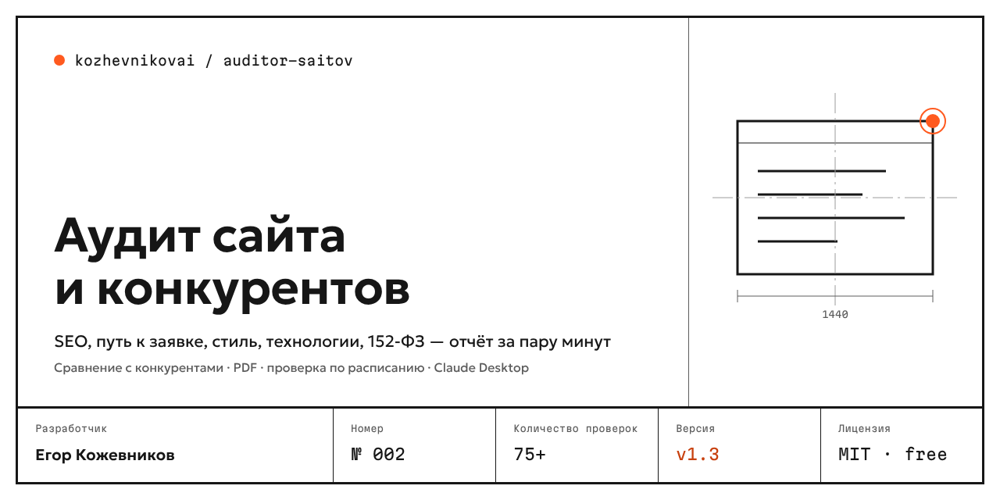
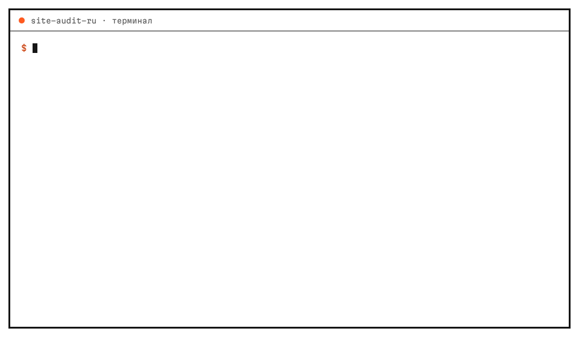
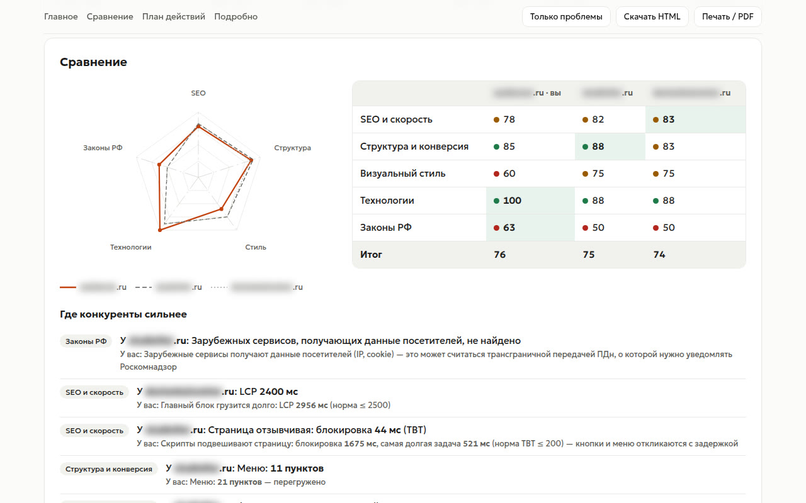
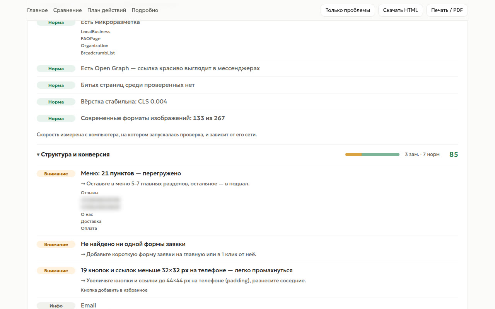
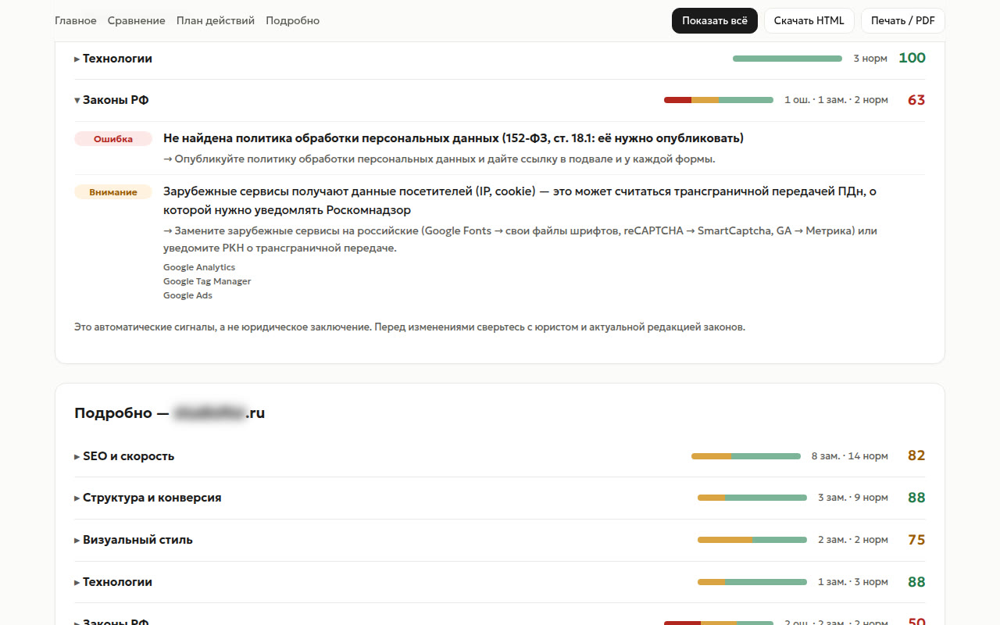

<p align="center"></p>

<p align="center"><a href="README.md">Русский</a> · <b>English</b></p>

# Auditor Saitov — website & competitor audit (Russia-focused)

The command and npm package are called `site-audit-ru`.

Give it your site and 2–4 competitors. In a couple of minutes you get a report: what keeps the site from generating leads, where competitors are stronger, what breaks Russian law, and what to fix first.

<p align="center"></p>

<sub>A real report on three real flower-delivery sites. Domains, names and phone numbers are blurred.</sub>

## Install in 3 steps

Requires Google Chrome, Microsoft Edge (built into Windows), Yandex Browser or Chromium.

1. Download **`site-audit-ru.mcpb`** from the [latest release](https://github.com/kozhevnikovai/auditor-saitov/releases/latest).
2. Double-click it: Claude Desktop offers to install the extension.
3. Ask Claude: *“Compare my site example.ru with competitors a.ru and b.ru and make a two-week plan”*.

## Features

- **Competitor comparison**, not just a checklist: radar chart, ranking and “where competitors are stronger”.
- **Russian law checks** most SEO tools skip: privacy policy, consent at every form (separate consent document since 1 Sep 2025), pre-checked boxes, cookies before consent, foreign services (cross-border data transfer), INN/OGRN, `erid` ad labels.
- **Yandex-first SEO and UX:** Yandex Metrica, sitemap, schema.org, LCP/CLS/TTFB, above-the-fold CTA, form length, click-to-call, messengers.
- **Competitor style in numbers:** HEX palette, fonts, type scale, WCAG contrast, desktop & mobile screenshots.
- **Deterministic data, optional AI.** A crawler collects reproducible facts; AI only interprets them.
- **New in 1.3.** Real-user speed from CrUX (with your free Google key), PDF report, scheduled checks on your own computer, export to Google Sheets without OAuth.
- **Local and free.** Runs in your own Chrome, Edge or Yandex Browser; nothing is sent anywhere; the report loads no external resources.

### Output

`report.html` (report with key panel, radar, action plan, filters, download and print), `report.pdf`, `report.xlsx`, `report.md`, `findings.csv` / `summary.csv` (Excel-ready: UTF-8 BOM, `;`), `audit.json`.

<p align="center"></p>

<p align="center"> </p>

## Other ways to install

- **Claude Code plugin:**
   ```text
   /plugin marketplace add kozhevnikovai/auditor-saitov
   /plugin install site-audit-ru@kozhevnikovai
   /site-audit example.ru a.ru b.ru
   ```
- **CLI (Node.js 20+):**
   ```bash
   npm install -g https://github.com/kozhevnikovai/auditor-saitov/releases/latest/download/site-audit-ru.tgz
   site-audit-ru example.ru a.ru b.ru --open
   ```
- **Any MCP client** (Cursor, Codex, Windsurf): command `npx -y <tarball-url> mcp`; tools `audit_sites`, `get_details`; prompt `site_audit_expert`.

Key CLI options: `-p` max pages (30), `-f html,md,csv,xlsx,json,pdf`, `--sheet <Apps Script URL>` (append results to your Google Sheet without OAuth, see [docs/google-sheets.gs](docs/google-sheets.gs)), `--crux-key <key>` (real-user Core Web Vitals from Chrome UX Report), `--open`, `--compare-last` (monitoring: what got fixed / appeared), `--webhook <url>` (n8n, Make, Zapier), `--ai` (with `ANTHROPIC_API_KEY` or any OpenAI-compatible `OPENAI_API_KEY` + `OPENAI_BASE_URL`).

Scheduled checks without a server: `site-audit-ru schedule add example.ru a.ru --every week --at 09:00` creates a Windows Task Scheduler task or a cron entry (macOS, Linux); each run is compared with the previous one. `schedule list`, `schedule remove <site>`.

## FAQ

**How long does it take?** About 2–5 minutes for three sites of 12 pages each, depending on the sites and your connection.

**Do I need an AI key?** No. All checks are done by code. A key is only needed for the AI conclusion in the CLI (`--ai`) and for CrUX data. In Claude Desktop and Claude Code, Claude writes the conclusion itself.

**Why does a competitor have no score?** The site is behind bot protection (Qrator, DDoS-Guard and similar). We do not bypass it and mark the check as incomplete.

**Is this legal advice?** No. The Russian law section shows automated signals. Check with a lawyer before making changes.

## Security and ethics

Respects `robots.txt`, max 30 pages, skips login/cart/account/search pages, identifies itself in the User-Agent, collects only public data. Bot-protected sites are marked as incomplete and are not scored. Legal findings are automated signals, not legal advice.

## License

MIT · Egor Kozhevnikov · product No. 002 of [kozhevnikovai](https://github.com/kozhevnikovai).
