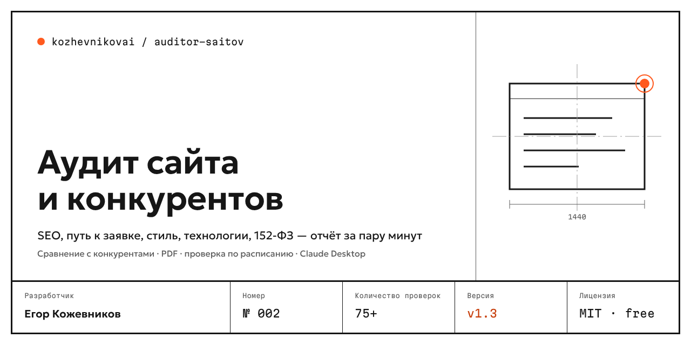
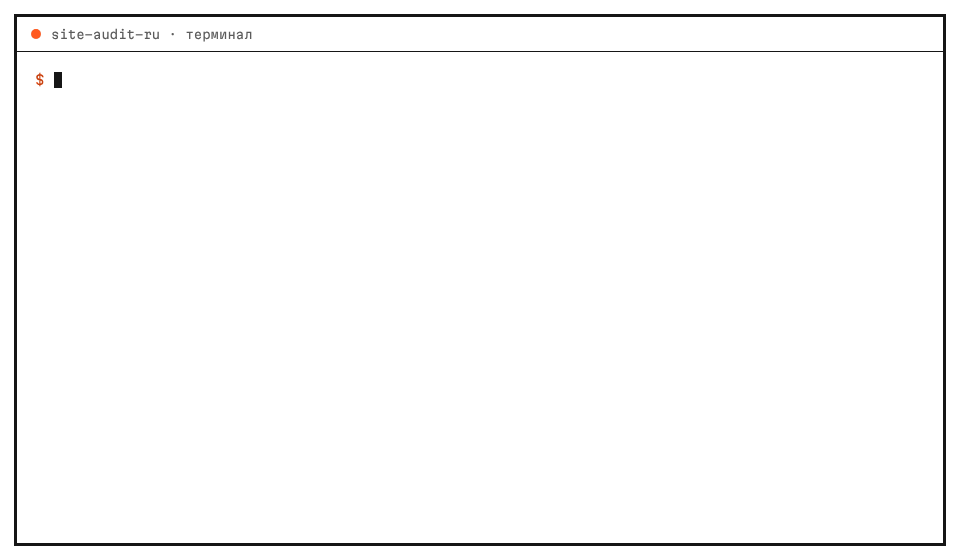
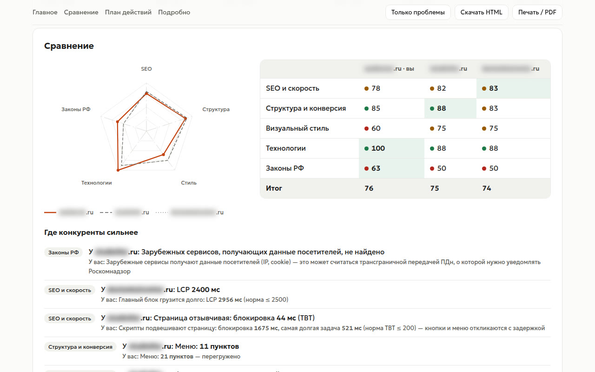
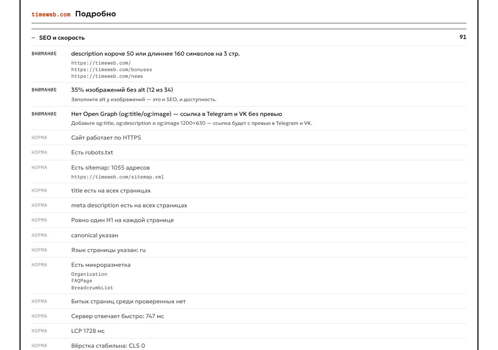

<p align="center"></p>

<p align="center">
<a href="https://github.com/kozhevnikovai/site-audit-ru/actions/workflows/ci.yml"></a>
<a href="https://github.com/kozhevnikovai/site-audit-ru/releases/latest"></a>


</p>

<p align="center"><b>Русский</b> · <a href="README.en.md">English</a></p>

# site-audit-ru — аудит сайта и конкурентов

Дайте адрес своего сайта и 2–4 конкурентов. Через пару минут получите отчёт: что мешает сайту приносить заявки, где конкуренты сильнее, что нарушает законы РФ и что исправить в первую очередь.

**Пять блоков, 60+ проверок:** SEO и скорость · структура и путь к заявке · визуальный стиль · технологии и маркетинговые сервисы · соответствие законам РФ (152-ФЗ, cookie, реквизиты, маркировка рекламы).

<p align="center"></p>

## Почему этим стоит пользоваться

- **Сравнение с конкурентами, а не просто чек-лист.** Радар по пяти блокам, место среди сайтов и список «где конкуренты сильнее»: у них такая-то проверка в норме, а у вас — нет.
- **Законы РФ.** Политика ПДн, согласие у каждой формы, отдельный документ согласия (с 01.09.2025), галочки по умолчанию, cookie до согласия, зарубежные сервисы (Google Fonts, GA, reCAPTCHA, YouTube), ИНН и ОГРН, erid. Обычные SEO-сервисы этого не проверяют.
- **Сайт глазами Яндекса и посетителя.** Метрика, sitemap, микроразметка, LCP/CLS/TTFB, кнопка действия на первом экране, длина форм, кликабельный телефон, мессенджеры.
- **Стиль конкурента в цифрах.** Палитра в HEX, шрифты, шкала размеров, контраст текста, скриншоты для компьютера и телефона.
- **Цифры воспроизводимы.** Данные собирает детерминированный код, а не ИИ. ИИ только объясняет их и составляет план, если вы этого хотите.
- **Локально и бесплатно.** Проверка идёт в вашем браузере (Chrome, Edge или Яндекс Браузер). Данные никуда не отправляются, отчёт сам не грузит внешние ресурсы.

## Отчёт

HTML-отчёт в стиле «Чертёж» открывается в любом браузере. Его можно отправить клиенту одним файлом, распечатать или сохранить в PDF.

<p align="center"></p>

- **Главное.** Итоговая оценка и вердикт, число ошибок и замечаний, место среди конкурентов, три главные проблемы.
- **Сравнение.** Радар и таблица по блокам, где конкуренты сильнее.
- **План действий.** 10 задач по убыванию важности, у каждой подсказка «как исправить».
- **Подробно.** Все находки по блокам с цветовыми статусами, адресами страниц и палитрой сайта.
- **Кнопки:** «Только проблемы», «Скачать HTML», «Печать / PDF».

<p align="center"></p>

Рядом с HTML сохраняются:

| Файл | Для чего |
|---|---|
| `report.html` | Отчёт для людей: открыть, отправить, распечатать |
| `report.md` | Markdown для Notion, Obsidian, GitHub, Telegram и чата с ИИ |
| `findings.csv` | Все находки для Excel и Google Таблиц (UTF-8, `;`, открывается двойным щелчком) |
| `summary.csv` | Оценки строкой на сайт: удобно копить историю |
| `audit.json` | Все данные: для повторных отчётов, сравнения во времени и интеграций |

## Установка

Нужен установленный браузер: Google Chrome, Microsoft Edge (есть в каждой Windows), Яндекс Браузер или Chromium.

### 1. Claude Desktop — проще всего, без терминала

1. Скачайте **`site-audit-ru.mcpb`** со страницы [последнего релиза](https://github.com/kozhevnikovai/site-audit-ru/releases/latest).
2. Откройте файл двойным щелчком. Claude Desktop предложит установить расширение.
3. Напишите в чате: *«Сравни мой сайт example.ru с конкурентами a.ru и b.ru и составь план на две недели»*.

Claude проверит сайты, прочитает результаты как пять экспертов (SEO, UX, дизайн, техника, юрист) и даст заключение. Отчёты сохранятся в папку `site-audit` в вашей домашней папке.

### 2. Claude Code — плагин с командой `/site-audit`

```text
/plugin marketplace add kozhevnikovai/site-audit-ru
/plugin install site-audit-ru@kozhevnikovai
/site-audit example.ru a.ru b.ru
```

Плагин запускает проверку и пять подагентов-экспертов параллельно, а затем собирает общее заключение.

### 3. Командная строка — для регулярных проверок и автоматизации

Нужен Node.js 20 или новее.

```bash
npm install -g https://github.com/kozhevnikovai/site-audit-ru/releases/latest/download/site-audit-ru.tgz
site-audit-ru example.ru a.ru b.ru --open
```

Без установки, одной командой:

```bash
npx -y https://github.com/kozhevnikovai/site-audit-ru/releases/latest/download/site-audit-ru.tgz example.ru a.ru
```

### Другие ИИ-клиенты: Cursor, Codex, Windsurf

Это MCP-сервер, он работает в любом клиенте с поддержкой MCP:

```json
{
  "mcpServers": {
    "site-audit-ru": {
      "command": "npx",
      "args": ["-y", "https://github.com/kozhevnikovai/site-audit-ru/releases/latest/download/site-audit-ru.tgz", "mcp"]
    }
  }
}
```

Инструменты: `audit_sites` (проверка 1–5 сайтов), `get_details` (подробности по блоку), промпт `site_audit_expert`.

## Командная строка

```bash
site-audit-ru <ваш сайт> [конкуренты...] [параметры]
```

| Параметр | Что делает |
|---|---|
| `-p, --max-pages <n>` | Сколько страниц обойти на каждом сайте (по умолчанию 30) |
| `-f, --format <список>` | Форматы: `html,md,csv,json` (по умолчанию `html,md,csv`, JSON сохраняется всегда) |
| `-o, --out <папка>` | Куда сохранить (по умолчанию `site-audit/<дата>-<сайт>`) |
| `--open` | Открыть HTML-отчёт после проверки |
| `--compare-last` | Сравнить с прошлым прогоном этого сайта: что исправлено, что появилось |
| `--baseline <audit.json>` | Сравнить с конкретным прошлым прогоном |
| `--ai` | Добавить заключение ИИ-экспертов в отчёт (нужен ключ API, см. ниже) |
| `--webhook <url>` | Отправить сводку POST-запросом в n8n, Make, Zapier, Albato или Битрикс24 |
| `--no-screenshots` | Без скриншотов |
| `--ignore-robots` | Не учитывать robots.txt (только для своего сайта) |
| `--allow-private` | Разрешить адреса локальной сети — для аудита внутреннего сайта или localhost. По умолчанию такие адреса заблокированы, чтобы чужой сайт не мог направить проверку внутрь вашей сети |
| `--chrome-path <путь>` | Путь к браузеру, если он не нашёлся сам |

Другие команды:

- `site-audit-ru report <audit.json> -f html` — пересобрать отчёты из сохранённых данных;
- `site-audit-ru prompt` — вывести промпт экспертов (можно вставить в любой чат вместе с `report.md`);
- `site-audit-ru mcp` — запустить MCP-сервер.

### Мониторинг себя и конкурентов

Запускайте раз в неделю с `--compare-last`. В отчёте появится раздел «Изменения с прошлой проверки». Пример для планировщика Windows (`.bat`):

```bat
cd /d %USERPROFILE%\Documents
site-audit-ru example.ru a.ru b.ru --compare-last --webhook https://n8n.example.ru/webhook/site-audit
```

Сводка в webhook содержит оценки, пять главных проблем по каждому сайту и изменения. Из n8n или Make её легко отправить в Telegram, Битрикс24 или Google Таблицу.

### Заключение ИИ в CLI

Укажите ключ в переменной окружения и добавьте `--ai`:

```bash
# Anthropic (Claude)
export ANTHROPIC_API_KEY=...
# или любой OpenAI-совместимый API: OpenRouter, локальная Ollama и другие
export OPENAI_API_KEY=...  OPENAI_BASE_URL=https://openrouter.ai/api/v1  SITE_AUDIT_AI_MODEL=<модель>
site-audit-ru example.ru a.ru --ai --open
```

Промпты экспертов лежат в [`prompts/`](prompts). Они общие для CLI, MCP-сервера и плагина.

## Что проверяется

<details><summary><b>SEO и скорость</b></summary>

HTTPS, robots.txt и sitemap (включая индекс sitemap), title и description (наличие, длина, дубли), ровно один H1, canonical, язык страницы, noindex, alt у изображений, микроразметка schema.org, Open Graph, битые страницы, «тонкие» страницы, TTFB, LCP, CLS, вес главной.
</details>

<details><summary><b>Структура и конверсия</b></summary>

Мобильная адаптация и горизонтальная прокрутка на телефоне, меню верхнего уровня, кнопка действия на первом экране, сколько кликов до формы, длина форм, кликабельный телефон и телефон в шапке, мессенджеры (Telegram, WhatsApp, VK, MAX), разделы доверия (цены, отзывы, кейсы, вопросы, контакты), глубина страниц, страницы-сироты из sitemap.
</details>

<details><summary><b>Визуальный стиль</b></summary>

Палитра (текст, фон, рамки) и акцентные цвета, шрифты, шкала размеров текста, доля мелкого текста, контраст текста к фону по WCAG (фон ищется по родительским элементам), скругления, ширина контента, скриншоты 1440 и 390 px.
</details>

<details><summary><b>Технологии</b></summary>

45+ сигнатур: Tilda, 1С-Битрикс, WordPress, InSales, Next.js и Nuxt, Яндекс Метрика, Google Analytics и GTM, Top.Mail.ru, пиксели VK и Meta, Roistat, Calltouch, CoMagic, Callibri, Jivo, Carrot quest, Битрикс24, amoCRM, Marquiz, карты, видео, капчи, CDN; устаревший jQuery.
</details>

<details><summary><b>Законы РФ</b></summary>

Политика обработки ПДн (152-ФЗ, ст. 18.1), согласие у каждой формы с персональными данными (ищется и рядом с формой), отдельный документ согласия (с 01.09.2025), галочка согласия по умолчанию, уведомление о cookie и cookie аналитики до согласия, зарубежные сервисы (трансграничная передача), ИНН и ОГРН/ОГРНИП продавца, HTTPS для форм, маркировка рекламы (erid).

> Это автоматические сигналы, а не юридическое заключение. Перед изменениями сверьтесь с юристом.
</details>

## Как это работает и этика обхода

- Сборщик открывает страницы в headless-режиме вашего браузера через Playwright, ждёт, пока страница перестанет перезагружаться (JS-проверки), прокручивает главную, чтобы догрузились ленивые скрипты.
- Соблюдает `robots.txt`, обходит не больше 30 страниц, пропускает служебные разделы (вход, корзина, кабинет, поиск, фильтры), представляется в User-Agent как `site-audit-ru` со ссылкой на проект.
- Собирает только публичные данные, которые видит любой посетитель. Скриншоты и данные остаются на вашем компьютере.

**Ограничения.** Сайты под защитой от ботов (Qrator, DDoS-Guard, Servicepipe) помечаются как «проверка неполная» и не получают оценку. Скорость зависит от сети компьютера, с которого идёт проверка. Аналитика, которая загружается только после согласия на cookie, может не определиться.

## Разработка

```bash
npm install
npm test          # 26 тестов: тестовые сайты, отчёты, webhook, ИИ на фейковом API, настоящий MCP-клиент
npm run build
node dist/cli.js test-site.ru --open
```

Структура: `src/crawl.ts` — обход, `src/extract.ts` — сбор данных на странице, `src/analyzers/` — пять блоков проверок, `src/report/` — HTML, Markdown, CSV, webhook, сравнение, `src/mcp.ts` — MCP-сервер, `plugin/` — плагин Claude Code, `mcpb/` — расширение Claude Desktop, `prompts/` — промпты экспертов.

Новые проверки и сигнатуры технологий приветствуются: смотрите [CONTRIBUTING.md](CONTRIBUTING.md).

## Планы

- [ ] Браузерное расширение: аудит открытой страницы в один клик
- [ ] Lighthouse и Core Web Vitals из CrUX
- [ ] Прямая выгрузка в Google Таблицы и Яндекс Таблицы
- [ ] Проверка Яндекс Бизнеса и карточек в картах (по вашему аккаунту)
- [ ] Больше сигнатур российских сервисов

## Скоро

Всё, что есть сейчас, остаётся бесплатным и открытым (MIT). Платная версия — «site-audit-ru для агентств и отделов маркетинга» — в разработке, этих возможностей пока нет:

- **Проверка по расписанию** — сайт и конкуренты каждую неделю, уведомление о новых проблемах — *скоро*
- **Отчёт под вашим брендом** — логотип и цвета агентства, PDF — *скоро*
- **Весь сайт целиком** — больше 30 страниц, история изменений — *скоро*
- **Командный доступ и API** — *скоро*

Нужно что-то из этого? [Оставьте заявку на ранний доступ](https://github.com/kozhevnikovai/site-audit-ru/issues/new?template=early-access.yml) — заявки влияют на порядок разработки.

## Другие инструменты kozhevnikovai

- [Протоколист](https://github.com/kozhevnikovai/protokolist) — запись встречи → протокол, локально
- [Тендерный помощник](https://github.com/kozhevnikovai/tender-pomoshnik) — разбор госзакупок 44-ФЗ и 223-ФЗ с цитатами
- [ai-skills-ru-business](https://github.com/kozhevnikovai/ai-skills-ru-business) — 10 навыков для Claude: КП, отзывы, вакансии, регламенты

Об уязвимостях — приватно, см. [SECURITY.md](SECURITY.md).

## Автор

Егор Кожевников — [github.com/kozhevnikovai](https://github.com/kozhevnikovai). Продукт № 002 линейки kozhevnikovai; № 001 — [ИИ-навыки для бизнеса в России](https://github.com/kozhevnikovai/ai-skills-ru-business).

Лицензия MIT.
